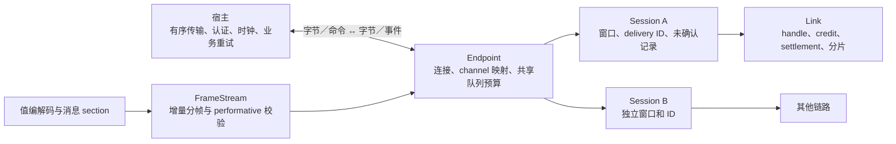

# AMQP 1.0 协议范围与复审验证

## 架构



`value.mbt`、`encode_value.mbt`、`decode_value.mbt` 和 `message.mbt` 可以独立使用。`frame.mbt`、`stream.mbt`、`performative.mbt` 负责线格式。`connection.mbt` 路由会话，`session.mbt` 管理 transfer 窗口，`links.mbt` 和 `flow.mbt` 管理链路和额度，`send.mbt`、`receive.mbt`、`settlement.mbt` 推进交付状态。Native CLI 与 Node 测试脚本通过标准流和 TCP 连接核心与外部 Broker。核心在 Native、JS、Wasm 和 Wasm-GC 上共享同一实现，宿主串行驱动。

## 三项协议语义

| 能力 | 复审实现 | 宿主契约和范围 |
| --- | --- | --- |
| 多 Session | `begin(channel=…)` 与双向 channel 映射支持本地、远端及同时发起的 Begin。各会话独立管理 transfer 窗口、handle、delivery ID、未确认记录和 End。双方交换 End 后可复用 channel。 | 默认上限 16，可配置 1–64，仍受对端 channel-max 约束。默认 channel 保留原有事件形状，其他 channel 的事件使用 `SessionEvent(local_channel, event)`。协议输入错误仍使整个 Endpoint 失败。 |
| Receiver Settle Mode Second | `attach(…, receiver_mode=Second)` 支持 Second。接收方先报告 terminal outcome 与 `settled=false`，继续保留记录。发送方回送 `settled=true`，接收方随后发出 `PeerSettled` 并释放记录。已预先结算的消息无需此握手。 | 默认为 First。需要对端配合。接收方接受 Second 链路上的 First transfer 覆盖，拒绝 First 链路上的 Second 覆盖。发送方按链路模式发送。结算事件表达协议状态，宿主负责写出已排队帧和维护业务幂等。 |
| Link drain | `grant(handle, credit, drain=true)` 允许发起有限额度拉取。发送方收到 `DrainRequested` 后可交付已有消息，再调用 `complete_drain`。未用额度通过推进 link delivery-count 归还，不消耗 transfer 窗口或 delivery ID。接收方在该轮完成后收到 `DrainCompleted(handle, unused)`。 | 同一接收链路一次只有一轮 drain。该轮内可收到分片，归还额度的 Flow 可以与分片交错，完成事件等待组装结束。应用提供计时、取消策略及消息来源。另有 `Endpoint::drain()` 用于取出待写字节，线协议上不发送 drain Flow。 |

当前仓库使用 `receive_at`、`poll_idle`、`drain_at` 驱动非零空闲超时。`npm run interop` 的 Rhea 实时对端等待 1500 ms 后再双向交换分片消息，并断言收到 MoonBit 心跳。已结算链路在同一会话内交换空 unsettled map 后可以重挂。

连接共享字节、帧数和事件队列预算，链路与未确认数量按会话计。无序网络不属于 TCP 端点目标。SASL／TLS 由宿主协商，当前发布包提供 AMQP 层。事务、替代消息格式、动态节点和进程重启后的持久化未列为已实现能力。范围依据 [OASIS AMQP 1.0 Transport §2.5–2.8](https://docs.oasis-open.org/amqp/core/v1.0/os/amqp-core-transport-v1.0-os.html)。

## 新增的应用接口

1. **批量结果确认**。对同会话连续、已接收完整、未报告且 settlement 模式一致的 delivery ID，`acknowledge_range(first, last, outcome, channel=…)` 生成一帧 Disposition。它在提交前检查序列跨度、每个 ID、分片和输出容量，失败后可以在相同待确认状态上重试。单条确认共用实现。适用于后台任务完成批次和采集写入批次。应用仍需决定哪些结果可以合并。
2. **会话流控快照**。`session_diagnostics()` 返回按本地 channel 排序的独立快照，包含本地和远端 channel、窗口、transfer 序列位置、两个方向的未确认数量以及正在等待发送方确认的数量。适用于区分链路额度不足、会话窗口不足和 Second 确认积压。旧 `diagnostics()` 继续查看默认会话及连接级预算。

设 S 为会话数，L 为相关链路数，P 为已跟踪未确认记录数，K 为确认批次大小。会话映射查找平均 O(1)，每条链路查找 O(L)。批量确认以 O(K + L) 校验、常数规模的额外工作状态生成一个 wire Disposition。逐条确认需要 K 帧，重复扫描链路时最多 O(K·L)；Second 仍需等对端结算。收到对端范围时只扫描已有 ID，检查链路状态并排序的总成本最坏 O(P log P + L)，空间 O(P + L)。快照时间 O(S log S + L + P)，空间 O(S + L)，其中 L、P 为各会话总和；快照适合按需采样。

## 复现

```sh
moon check --target all --deny-warn
moon build --target all --deny-warn
moon test --target all --deny-warn
moon run examples/review --target native --deny-warn
npm ci --ignore-scripts --no-audit --no-fund
npm run interop
python scripts/run_artemis_interop.py /path/to/apache-artemis-2.44.0
```

- **本地回归**。覆盖同时 Begin、重复 channel、会话上限、跨会话相同 delivery ID、会话关闭后复用、Second 确认、批量失败原子性、drain 回卷及分片中途到达的 Flow。示例在同一连接上隔离会话，以一帧确认两条任务并归还一个空闲 credit。
- **独立 Rhea 3.0.5 对端**。`npm run interop` 比较 27 组合法类型及消息、帧流，并分别使用 First 和 Second 双向传送 5000 字节消息。Second 场景检查接收方 Accepted 尚未结算和发送方最终结算两个方向。
- **Apache ActiveMQ Artemis 2.44.0**。启动仅监听回环地址的临时 Broker，使用两条预建 ANYCAST 队列。MoonAMQP1 在一条 TCP 连接上开两个 Session。MoonAMQP1 → Artemis → Rhea 检查 5000 字节、应用属性、Accepted。Rhea → Artemis → MoonAMQP1 检查 6000 字节和 5 字节消息、应用属性、Accepted，关闭后用 Rhea 复查无重投。两方向共观察到 11／14 帧，每个 Transfer 帧不超过 512 字节。第一轮 drain 消费一条 5 字节消息并退还两个 credit，第二轮在空队列上退还全部两个 credit。此路径使用 First；Second 的独立对端证据来自 Rhea。Artemis 启动器要求 Java 17+，Linux CI 固定下载版本与 SHA-256。

Artemis 的 6000 字节消息走普通额度，实际 drain 用例使用单帧消息及空队列。探索性测试中，如果在 512 字节帧长下直接对含 6000 字节消息的队列发起 drain，观察到 Artemis 返回额度后未补齐余下分片。核心回归用例单独验证 Flow 夹在分片间且后续分片正常到达的情形。

新增事件构造器后，既有对 `Event` 进行穷举匹配的宿主需处理新分支。其余调用可继续省略 channel，使用默认会话。

## 未结算交付恢复

配置已认证对端专属的 `RecoveryStore`，并将其传给旧、新 `Endpoint::new(recovery=Some(store))`。发起方用 `attach(..., recoverable=true)` 请求保留固定终端，源与目的地声明 `expiry-policy=never`。宿主串行驱动端点。传输中断时调用 `transport_lost`，在相同容器身份的新连接上 `Open`、`Begin`，再调用 `resume_link`。仅在原会话暂停时可直接使用 `suspend_link` 和 `resume_link`。宿主认证身份后选择存储实例，容器 ID 只是 AMQP 协议中的标识。

对端完整表中缺少的接收方记录按已结算回收。发送方独有记录由 `unseen_deliveries` 枚举，宿主可用 `take_unseen` 取回消息并按业务策略选择新交付。双方共有记录由发送方在获得 credit 后调用 `resumable_deliveries` 和 `resume_delivery`。若新链路的任一侧报告不完整表，省略项仍为未知，双方只推进可对账记录。恢复完成本轮可处理的记录后，通过 `recovery_status` 判断是否仍需暂停重挂。再次交换完整表后即可继续普通发送。部分表按帧预算轮换可发前缀，使未展示的标签在后续轮次获得对账机会。在线上忽略本地未知的恢复交付，对不完整表期间发起的新交付发出链路级错误 Detach。

接收方用既有 `Received` 事件投递完整的新消息。已投递但未确认的消息恢复后发出 `DeliveryRebound(handle, id, tag)`，供宿主使用新会话编号结算。按对端完整表回收的接收方独有记录发出 `RecoverySettled(handle, tag)`。直接结算的已知终态用空载荷恢复帧表示，首次恢复使用新会话 delivery ID。消息在等待发送方结算时只保留结果和标签。

`moon run examples/recovery --target js --deny-warn` 输出框架的线级记录。 `npm run interop:recovery` 由 Rhea 3.0.5 独立解码，验证 620 字节帧上限、首轮部分表与次轮完整表、从 section 0 的偏移处继续、重组出的 1,400 字节消息，以及两端的 Second 结算。此用例由两个 MoonAMQP1 状态机驱动，Rhea 负责独立线级解释。常规 TCP 对端互操作的证据见前文。

适用的标准必需行为以 OASIS Part 0 §0.2 为目标。类型、分帧、连接／会话／链路、流控、标准消息和结算属于核心。终端状态可用时，部分表限制、恢复旗标、按 tag 对账及重新结算适用 Transport §2.6.13、§2.7.3 和 Messaging §3.4.6。事务控制器及资源角色、动态节点、替代格式和外部持久存储属于独立能力。收到事务协调器或不支持的终端能力请求时，回空终端 Attach 和带错误 Detach。收到未支持的事务性获取请求时，以 amqp:not-implemented 结束相应链路。原 Session 继续用于普通链路。Part 5 建议的安全层由传输宿主承担，相关认证和加密能力须按其配置验收。[OASIS Part 0](https://docs.oasis-open.org/amqp/core/v1.0/os/amqp-core-overview-v1.0-os.html) · [Transport](https://docs.oasis-open.org/amqp/core/v1.0/os/amqp-core-transport-v1.0-os.html) · [Messaging](https://docs.oasis-open.org/amqp/core/v1.0/os/amqp-core-messaging-v1.0-os.html)

### 同名链路接管

同一服务的多个 Endpoint 使用同一个 RecoveryStore，由宿主串行驱动。两个容器的身份、链路名和传输方向共同标识一条链路。第二条连接挂接同一标识时，端点先准备新连接的 Attach 及旧连接的 Detach，同时检查两个连接的输出和事件预算。检查通过后，旧链路以 amqp:link:stolen 结束。旧连接的其他链路继续工作。已开启恢复的旧链路，其待结算标签、结果和载荷前缀转移到新链路，旧会话的 delivery ID 随旧绑定失效。

在主动 TCP 用例中，独立的 Node 端使用 Rhea 编解码并维护跨连接的收发状态。scripts/recovery_broker.cjs 分别作为发送方和接收方与 Native 端点交换 Attach、Flow、Transfer、Detach 和 Disposition。用例记录两轮待结算表、恢复偏移、完整的 1,400 字节正文和恢复后的普通交付。构建 Native CLI 后运行 npm run interop:recovery:tcp 即可复现。