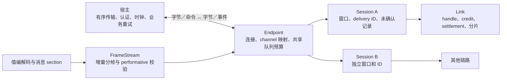

# AMQP 1.0 协议范围与复审验证

## 架构



`value.mbt`、`encode_value.mbt`、`decode_value.mbt` 和 `message.mbt` 可以独立使用。`frame.mbt`、`stream.mbt`、`performative.mbt` 负责线格式。`connection.mbt` 路由会话，`session.mbt` 管理 transfer 窗口，`links.mbt` 和 `flow.mbt` 管理链路和额度，`send.mbt`、`receive.mbt`、`settlement.mbt` 推进交付状态。Native CLI 与 Node 测试脚本通过标准流和 TCP 连接核心与外部 Broker。核心在 Native、JS、Wasm 和 Wasm-GC 上共享同一实现，宿主串行驱动。

## 三项协议语义

| 能力 | 复审实现 | 宿主契约和范围 |
| --- | --- | --- |
| 多 Session | `begin(channel=…)` 与双向 channel 映射支持本地、远端及同时发起的 Begin。各会话独立管理 transfer 窗口、handle、delivery ID、未确认记录和 End。双方交换 End 后可复用 channel。 | 默认上限 16，可配置 1–64，仍受对端 channel-max 约束。默认 channel 保留原有事件形状，其他 channel 的事件使用 `SessionEvent(local_channel, event)`。协议输入错误仍使整个 Endpoint 失败。 |
| Receiver Settle Mode Second | `attach(…, receiver_mode=Second)` 支持 Second。接收方先报告 terminal outcome 与 `settled=false`，继续保留记录。发送方回送 `settled=true`，接收方随后发出 `PeerSettled` 并释放记录。已预先结算的消息无需此握手。 | 默认为 First。需要对端配合。接收方接受 Second 链路上的 First transfer 覆盖，拒绝 First 链路上的 Second 覆盖。发送方按链路模式发送。结算事件表达协议状态，宿主负责写出已排队帧和维护业务幂等。 |
| Link drain | `grant(handle, credit, drain=true)` 允许发起有限额度拉取。发送方收到 `DrainRequested` 后可交付已有消息，再调用 `complete_drain`。未用额度通过推进 link delivery-count 归还，不消耗 transfer 窗口或 delivery ID。接收方在该轮完成后收到 `DrainCompleted(handle, unused)`。 | 同一接收链路一次只有一轮 drain。该轮内可收到分片，归还额度的 Flow 可以与分片交错，完成事件等待组装结束。应用提供计时、取消策略及消息来源。另有 `Endpoint::drain()` 用于取出待写字节，线协议上不发送 drain Flow。 |

连接共享字节、帧数和事件队列预算，链路与未确认数量按会话计。无序网络、SASL／TLS、非零 idle timeout、事务、恢复、非零 message-format、动态或持久 terminus 和 Broker 队列存储由当前实现范围排除。范围依据 [OASIS AMQP 1.0 Transport §2.5–2.8](https://docs.oasis-open.org/amqp/core/v1.0/os/amqp-core-transport-v1.0-os.html)。

## 新增的应用接口

1. **批量结果确认**。对同会话连续、已接收完整、未报告且 settlement 模式一致的 delivery ID，`acknowledge_range(first, last, outcome, channel=…)` 生成一帧 Disposition。它在提交前检查序列跨度、每个 ID、分片和输出容量，失败后可以在相同待确认状态上重试。单条确认共用实现。适用于后台任务完成批次和采集写入批次。应用仍需决定哪些结果可以合并。
2. **会话流控快照**。`session_diagnostics()` 返回按本地 channel 排序的独立快照，包含本地和远端 channel、窗口、transfer 序列位置、两个方向的未确认数量以及正在等待发送方确认的数量。适用于区分链路额度不足、会话窗口不足和 Second 确认积压。旧 `diagnostics()` 继续查看默认会话及连接级预算。

设 S 为会话数，L 为相关链路数，P 为已跟踪未确认记录数，K 为确认批次大小。会话映射查找平均 O(1)，每条链路查找 O(L)。批量确认以 O(K + L) 校验、常数规模的额外工作状态生成一个 wire Disposition。逐条确认需要 K 帧，重复扫描链路时最多 O(K·L)；Second 仍需等对端结算。收到对端范围时只扫描已有 ID，检查链路状态并排序的总成本最坏 O(P log P + L)，空间 O(P + L)。快照时间 O(S log S + L + P)，空间 O(S + L)，其中 L、P 为各会话总和；快照适合按需采样。

## 复现

```sh
moon check --target all --deny-warn
moon build --target all --deny-warn
moon test --target all --deny-warn
moon run examples/review --target native --deny-warn
npm ci --ignore-scripts --no-audit --no-fund
npm run interop
python scripts/run_artemis_interop.py /path/to/apache-artemis-2.44.0
```

- **本地回归**。覆盖同时 Begin、重复 channel、会话上限、跨会话相同 delivery ID、会话关闭后复用、Second 确认、批量失败原子性、drain 回卷及分片中途到达的 Flow。示例在同一连接上隔离会话，以一帧确认两条任务并归还一个空闲 credit。
- **独立 Rhea 3.0.5 对端**。`npm run interop` 比较 27 组合法类型及消息、帧流，并分别使用 First 和 Second 双向传送 5000 字节消息。Second 场景检查接收方 Accepted 尚未结算和发送方最终结算两个方向。
- **Apache ActiveMQ Artemis 2.44.0**。启动仅监听回环地址的临时 Broker，使用两条预建 ANYCAST 队列。MoonAMQP1 在一条 TCP 连接上开两个 Session。MoonAMQP1 → Artemis → Rhea 检查 5000 字节、应用属性、Accepted。Rhea → Artemis → MoonAMQP1 检查 6000 字节和 5 字节消息、应用属性、Accepted，关闭后用 Rhea 复查无重投。两方向共观察到 11／14 帧，每个 Transfer 帧不超过 512 字节。第一轮 drain 消费一条 5 字节消息并退还两个 credit，第二轮在空队列上退还全部两个 credit。此路径使用 First；Second 的独立对端证据来自 Rhea。Artemis 启动器要求 Java 17+，Linux CI 固定下载版本与 SHA-256。

Artemis 的 6000 字节消息走普通额度，实际 drain 用例使用单帧消息及空队列。探索性测试中，如果在 512 字节帧长下直接对含 6000 字节消息的队列发起 drain，观察到 Artemis 返回额度后未补齐余下分片。核心回归用例单独验证 Flow 夹在分片间且后续分片正常到达的情形。

新增事件构造器后，既有对 `Event` 进行穷举匹配的宿主需处理新分支。其余调用可继续省略 channel，使用默认会话。
